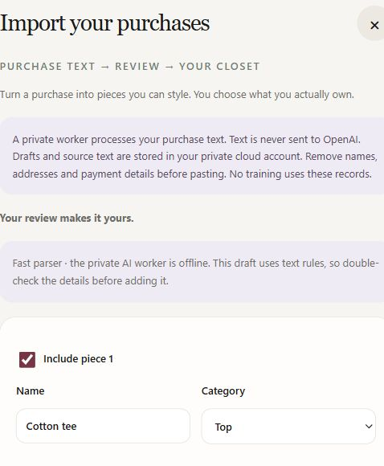

# Closet Quest: purchase extraction, fine-tuning and cloud validation

**Historical v1 checkpoint.** The follow-up [v2 model and GPU-memory report](purchase-ml-v2-report.md) contains the new training run, paired comparisons and remaining failures. The v1 results below are preserved as the before-change evidence.

**Try the app:** [Closet Quest](https://closet-quest-junhao-s7.onrender.com/). Sign in and open **Add clothes → Import purchases**. Please try a short clothing purchase, check the proposed fields and tell us what needed correction. Remove addresses and payment details first.

This report covers the next stage of **purchase-text import**, not a new image-recognition benchmark or a claim about outfit acceptance. It replaces the earlier M0–M1 review checkpoint for this feature. The implementation, synthetic dataset, per-example predictions and failed attempts are available for review. No participant results are invented.

## What was actually implemented

The hosted Node app stores drafts and jobs in the existing free Supabase project. When started, an outbound worker on the existing laptop claims a job through HTTPS, runs a local model and returns a draft. The browser shows the source evidence and editable fields. Saving a review and confirming ownership are separate requirements before a transaction adds garments to the cloud closet. The experimental model server was stopped after its live experiment; the hosted app currently uses the parser fallback. No unreliable candidate was left running as a production default.

The worker has a seven-day, revocable credential stored only on the inference computer. Supabase stores its hash. It can claim queued purchase text and return results, including jobs from different app users; it cannot read wardrobes or approve purchases. No service-role key is installed in the worker. Ollama and the experimental adapter server remain on loopback and are not exposed to the internet.

Deployment is verified: Render reports commit `c3b4555` live, GitHub Linux CI passed, and `/healthz` returned HTTP 200. In the signed-in production interface, a synthetic tee purchase produced the expected parser draft; saving review enabled the ownership control while insertion stayed blocked until confirmation. The saved draft and review state survived a full page reload and reopening the importer. This check did not add a synthetic garment to the real wardrobe.

When no recent worker heartbeat exists at creation time, the app runs a small, explicitly labeled **fast parser** on Render. It copies supported text fields and leaves missing values unknown. This is a real fallback, not an AI result. Free hosting does not provide an always-on GPU: Render can sleep, the laptop must be awake for model inference, and the scoped credential expires. The experiment added no rented GPU or paid inference calls; normal free-tier quotas and laptop electricity still apply.

The data path is: **signed-in browser → Node API with user JWT → owner-scoped Supabase draft and durable queue → outbound model worker → validated review draft → explicit user approval → atomic wardrobe transaction**. The fallback joins the same review path. Purchase sources do not enter training automatically.

## Evaluation design and actual training

The versioned dataset contains **300 training, 60 validation and 60 final-test documents**, all synthetic. Its 16 merchant/template families are split 10/3/3 without family overlap. Exact source hashes are disjoint. The splits share clothing vocabulary, so this is a test of these held-out formats, not proof of generalization to arbitrary merchants. Labels were authored programmatically and all 420 passed the application's canonical contract and evidence validator.

The test set has 60 clothing lines and 360 expected fields. Cases include complete and missing attributes, multiple garments, fees without garments, return warnings, embedded instructions, missing quantities, mixed non-clothing lines, Unicode and quantity two. Every attempted document stays in the results, including malformed JSON, token limits and rejected evidence. Invalid application output counts as empty for usable-line and field scores.

Whole-document exactness checks garment fields and line membership, not every exclusion reason or warning. Six documents contain no garments. Evidence-substring correctness is measured separately. The existing Ollama adapter rejects invalid responses before returning them, so failed Ollama records retain the error rather than the rejected full completion. No human correction burden or acceptance rate is inferred from these metrics.

The trainable model is [Qwen2.5-0.5B-Instruct](https://huggingface.co/Qwen/Qwen2.5-0.5B-Instruct), pinned to revision `7ae557604adf67be50417f59c2c2f167def9a775`, under its Apache-2.0 license. Completion-only supervised fine-tuning used LoRA rank 16, alpha 32, dropout 0.05, learning rate 0.0002, batch size one with four-step gradient accumulation, BF16 and gradient checkpointing. It trained 8,798,208 adapter parameters on the RTX 4060 Laptop GPU. Prompt tokens were masked before training; no test examples were used for checkpoint selection.

**The planned 120-step run failed with CUDA out of memory at step 71.** It did not finish successfully. The evaluated candidate is the saved validation checkpoint at step 40, about 0.53 training epochs. Its validation loss was 0.002279. The recovered safetensors were checked for finite values. No optimizer pickle was loaded for inference. One device-memory sample was 7,939 MiB; this is not a measured peak. The training log and failure record are retained.

The candidate artifact is 35,237,104 bytes with SHA-256 `6817041bfab2a1ea0b16840813b6414078b57d96a91eb023e1690b773d23933a`. Weights remain in the ignored local `ml/checkpoints/purchase-lora-v1/adapter` directory. GitHub contains the recipes, manifests and results, not a claim that the weights were uploaded. The source now saves additional early training diagnostics; those new files were not emitted by the original failed run.

## Results and interpretation

All four methods completed the same frozen 60-document test. These are measured results, including every failed attempt.

| Method, same 60-document test | Contract-valid documents | All garment fields exact | Usable line recall | Field exact match |
|---|---:|---:|---:|---:|
| Simple vocabulary/field parser | 60/60 | 6/60 | 60/60 | 300/360 (83.3%) |
| Untuned Qwen2.5 0.5B, same unconstrained protocol | 0/60 | 0/60 | 0/60 | 0/360 (0.0%) |
| Existing Qwen3-VL 4B application adapter | 24/60 | 6/60 | 4/60 | 20/360 (5.6%) |
| LoRA checkpoint 40 | 55/60 | 46/60 | 45/60 | 270/360 (75.0%) |

These metrics answer different questions. The simple parser keeps verbose source text as the description, which hurts exact-description scoring while retaining every clothing line in this constructed set. The adapter often produces the desired shorter description but sometimes omits the garment entirely. Its higher whole-document score does **not** establish that it is better overall. Its category macro-F1 is 0.8523, and five responses fail the application's contract despite all 60 parsing as JSON objects. The candidate is **not promoted to the default**.

The paired fine-tuning improvement is substantial for this contract: **0/60 to 55/60 usable documents**, and **0/360 to 270/360 exact usable fields**, with the same base model and unconstrained generation protocol. The untuned model's zero is an application-validity score, not a claim that it understood no clothing: 55 responses had unexpected or missing fields, three hit the output cap, and two failed JSON parsing. Strict validation rejected all of them. Fine-tuning taught the output contract, but it did not remove semantic omissions.

Failure breakdown makes the risk clearer. The adapter was exact on 6/6 complete, fee-only, injection and Unicode cases, but only 2/6 unknown-attribute cases and 1/6 returned-item cases. It preserved 27/48 expected null fields when missing items and rejected outputs count as errors. Only 1/6 return cases retained the expected garment and warning. All 243 emitted evidence quotes were real substrings, yet the model still omitted garments: quote validity alone is insufficient. The runtime JavaScript parser was evaluated separately from the Python reference using the same canonical scorer.

The existing 4B application model performed poorly on these formats: 36/60 results were rejected, commonly for missing description/category evidence or quotes absent from the cited line. Valid responses also omitted clothing, leaving only 4/60 usable garment lines. Its six exact documents were the six fee-only cases. This result argues for keeping the parser available and revisiting the extraction prompt/serving contract, not disabling evidence validation to make the model appear more accurate.

Base and adapter generation use the same prompt, tokenizer, greedy decoding and 1,400-token output cap without a grammar constraint. The existing 4B application baseline has its existing schema-constrained Ollama protocol and 2,048-token cap; that is an application-level comparison, not an isolated comparison of model size. Quality runs overlap on the same laptop. Their recorded latency is descriptive under shared load and must not be presented as a controlled speedup.

A separate, serial timing probe used the first five validation receipts with Ollama unloaded and one model at a time. Median generation was **26.26 seconds untuned versus 2.52 seconds tuned**; the four warm requests had medians of 26.11 and 2.52 seconds. Model load took 1.80 and 2.32 seconds, separately. This is **not evidence of a useful tenfold speedup**: the tuned model emitted empty results on four of five receipts, only one of which truly contained no clothes. It retained just 2/5 clothing lines and was exact on 2/5 documents in this timing subset. Shorter, incomplete outputs explain much of the latency reduction. The small fixed-order probe does not establish production cold-start or p95 latency.

An additional live cloud experiment used the saved adapter on a receipt outside the generated test formats. The full claim/infer/finish path completed in **3.715 seconds**, with model inference reported at **2.813 seconds**. Supabase accepted a review draft, but the model returned **zero garments** for a receipt containing linen trousers. It incorrectly classified the clothing line as shipping. This is a successful transport experiment and a failed extraction experiment. No garment was inserted. The raw response is preserved in `output/purchase-ml/cloud/live-candidate-result.json`.

## Cloud robustness experiments

| Experiment | Actual result | What it establishes |
|---|---:|---|
| Live Supabase SQL isolation/transaction checks | 8/8 passed | Foreign-owner access denied; second-unit failure rolls back all writes; valid commit is atomic; stale review is rejected; unique mappings are enforced |
| Live HTTPS/PostgREST worker checks | 6/6 passed | Invalid credential and anonymous read denied; three concurrent claims grant one lease; wrong lease rejected; result completion and replay are safe |
| Hosted browser rehearsal | 7/7 observed checks passed | Import entry, worker configuration, labeled fallback, expected synthetic fields, review/ownership gate, reload persistence and cancellation; no wardrobe insertion |
| Local application suite | 244 Node tests passed | Contract, authorization, lifecycle, recovery, queue and existing app behavior under automated fixtures |
| Evaluation unit tests | 3 Python tests passed | Split isolation and metric denominators; failures count against quality |
| Production build | Passed | Frontend and server packaging checks, not a live usability guarantee |

The SQL experiment used two existing identities through database roles and `auth.uid()` settings. It was not a two-browser authentication test. All experimental wardrobe writes were rolled back within the experiment, leaving actual closets unchanged. The HTTPS lease test used a deterministic fixture to isolate queue behavior; it is not counted as model accuracy. An initial harness expected HTTP 403 while the service returned HTTP 401; the assertion was corrected to accept either denial and the original mismatch was retained.

Jobs have exclusive leases, revision and generation checks, a 180-second lease, a 120-second inference deadline and at most three attempts. Queue capacity is eight active jobs per owner and 200 globally. Cancellation and parser-completed drafts release slots. A deployment check found an empty generated replacement-migration file; it was rebuilt, tested, applied and its live function definitions verified. These fixes are in migrations 004 and 005.

## Failures, risks and next priorities

1. **Improve recall before promotion.** The adapter's missed and misclassified clothing lines, including the live receipt failure, outweigh the appealing validation loss. Next work should add independently labeled, consented receipts and more varied formats, use a fresh untouched test set, and compare grammar-constrained decoding. Reusing this test set to choose changes would turn it into development data.
2. **Reduce training memory pressure.** The current run cannot be described as a completed training job. A future bounded run should measure sequence-length memory, reduce the context budget or use a smaller adapter/quantized training configuration, then repeat the full evaluation. No larger GPU was rented to hide the failure.
3. **Measure human usefulness.** Correction time, accepted imports and time saved versus manual entry remain unmeasured. Exact fields and valid JSON are technical proxies, not evidence of user satisfaction or social impact. A consented crossover study is the next meaningful product test.
4. **Strengthen availability.** Free hybrid deployment stores jobs durably but depends on this computer for AI. A worker disappearing just after its heartbeat can leave a draft waiting until a worker returns or the user cancels; expiration cleanup runs when a worker polls. Credential renewal and monitoring are operational work still required. The parser handles only a narrow vocabulary and field syntax.
5. **Keep review and privacy boundaries.** Source-quote validation checks substrings, not whether the model interpreted them correctly. A valid empty result can still be wrong. Return/cancellation text does not establish ownership. Sources remain until removal, and deletion does not erase provider backups or database WAL. There is no automatic PII redaction, OCR, arbitrary URL fetching or email ingestion in this feature.

The main deployment rollback is to set `CLOSET_PURCHASE_IMPORTS=0`; keep durable drafts intact. Revoke worker access by disabling its registry entry. Do not drop import tables to roll back the UI. Existing wardrobe and styling paths remain independent of this feature.

## Reviewer handoff

Start with `server/purchase-contract.js`, `server/purchase-imports.js`, `server/purchase-cloud-store.js`, `server/purchase-worker-client.js` and migrations 003–005. The browser surface is `src/PurchaseImportPanel.jsx`. Evaluation and training are in `ml/purchase/`; raw evidence is under `output/purchase-ml/`. The dataset manifest records exact split hashes, and the model manifest pins upstream files.

The implementation was published to remote `main` through explicit GitHub file updates to preserve the existing local work. The local checkout was not reset or rebased and still has earlier uncommitted changes; use remote commit `c3b4555` as the implementation review checkpoint rather than assuming local `HEAD` describes this release. The subsequent report/evidence update does not change the deployed application runtime.

Run `npm test`, `npm run build` and `python -m unittest discover -s ml/purchase -p test_evaluation.py`. The [reproduction notes](../ml/purchase/README.md) distinguish local inference, actual training and cloud experiments. Review semantic omissions and failed examples before making a deployment decision; low training loss is insufficient.
