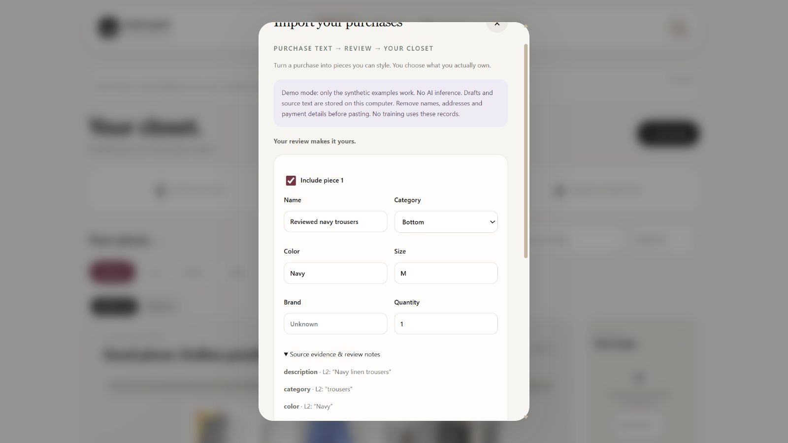
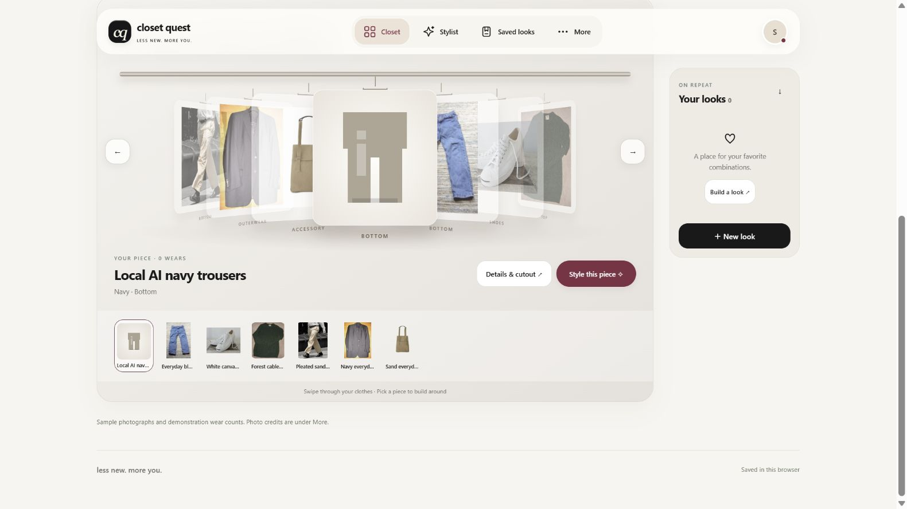

# Smart Wardrobe Import: implementation and review handoff

October 30, 2026 · M0–M1 / T00–T06 checkpoint

**Existing deployed app:** [Try Closet Quest](https://closet-quest-junhao-s7.onrender.com/). The new import feature is working locally and remains disabled on production. Its Supabase migration has not been applied to the live project. This report is for reviewing the implementation before cloud enablement or model training.

## What changed for a user

Someone can now paste clothing purchase lines from a receipt into **Add clothes → Import purchases**. The app extracts a draft, shows the exact source quotes, and lets the person correct the name, category, color, size, brand and quantity. The person saves their review and confirms that they actually own the selected pieces before anything enters the closet. Two purchased units become two distinct garments. A repeated commit returns the previous receipt instead of adding duplicates.

Missing attributes stay unknown. Shipping and discounts stay out of the closet. An imported item has no fabricated photograph: it uses the existing neutral placeholder until a photo is added. A purchase is evidence of text, not proof of ownership, authenticity, condition or fashion suitability.

The supplied plan explicitly sets a review checkpoint after T06. This implementation stops there. No model was fine-tuned, no weights were downloaded, no GPU service was rented, and no private receipts were sent to a remote provider. GitHub publication follows the user's direct request.

## Implementation map

| Ticket | Implemented files and decision | Verification |
|---|---|---|
| T00 Audit | [Local model baseline](local-model-baseline.md); reused React, Node, Ollama and existing authentication | Existing suite: 219 passing tests; actual runtime/hardware and installed model digests recorded |
| T01 Contract | `contracts/purchase-extraction.schema.json`, `server/purchase-contract.js`, `tests/fixtures/purchase-import/cases.js` | Strict key/type/limit checks, immutable line IDs/hash, exact quote validation, 12 named fixture cases |
| T02 Storage | `server/purchase-store.js`, `server/purchase-cloud-store.js`, `supabase/migrations/003_purchase_imports.sql` | SQLite transaction/restart tests and executable PostgreSQL tests for RLS, rollback, CAS and uniqueness |
| T03 Local extraction | `server/purchase-provider.js`, `server/model-config.js` | Existing local `agents.chat` adapter, real Qwen smoke, preserved Gemma failures, no remote fallback |
| T04 Job/API | `server/purchase-imports.js`, `server/api.js`, `server/cloud.js` | Async acknowledgement, queue bounds, cancel/retry, stale revisions, late completion, origin checks, feature flag and replay tests |
| T05 Review UI | `src/PurchaseImportPanel.jsx`, `src/purchase-import.css`, `src/App.jsx` | Browser fixture and real-model flows; correction, saved review, ownership confirmation and immediate closet update |
| T06 Integration | `src/purchase-import.js`, `src/cloud-sync.js`, new tests and demo scripts | 240 tests pass, zero failures/skips; production build passes; receipt replay cannot re-add a previously applied unit |

Draft items live inside the versioned draft JSON rather than a separate item table. Commit mappings remain relational and unique by import, item and unit. This keeps one compare-and-swap boundary around the review while preserving duplicate protection. The existing photo queue assumes image input, so purchase imports use a small task-specific ledger while sharing the local inference availability boundary. These are deliberate mappings of the plan, not a second app or framework rewrite.

## Actual evidence

| Check | Observed result | What it establishes |
|---|---|---|
| Before/after regression suite | 219 → 240 passing tests; 21 new cases, no failures or skips | Added coverage and no detected regression; not model accuracy |
| Production build | Passed; 94 modules transformed | Frontend bundles successfully |
| Gemma real probes | 2 rejected results: unsupported quote, then missing description evidence | Invalid structured output is stopped before review/commit |
| Qwen real probes | 2 accepted extractions of the same synthetic purchase | The actual installed local adapter can satisfy this contract |
| Documented Qwen smoke | 6,916.93 ms total; 6,786 ms reported provider latency; 346 output tokens | One development measurement; residency was uncontrolled |
| Fixture browser flow | Six-piece sample closet became seven after review and confirmation | End-to-end UI integration with deterministic data |
| Real Qwen browser flow | Draft survived reload; corrected “Local AI navy trousers” appeared in the seven-piece closet | Real inference, persistence, review and insertion connect without a refresh workaround |
| Local PostgreSQL tests | RLS, anonymous denial, cross-owner child-row denial, CAS, uniqueness and injected multi-unit rollback passed | SQL behavior under test roles; not a live Supabase security audit |

All purchase inputs above are synthetic. The real-model probes reuse one short Harbor Demo Store example. They are not a held-out benchmark and cannot support an accuracy percentage, a cold/warm speedup or a human acceptance claim. The Qwen output included size and quantity in its description; the browser review corrected that verbosity. Fixture success and mocked failures do not count as real model successes.

Evidence: [test output](../output/smart-import/tests.txt), [build output](../output/smart-import/build.txt), [reproducible smoke record](../output/smart-import/smoke-qwen3-vl_4b-instruct-q4_K_M.json), [browser observations](../output/smart-import/browser-observations.json), and the preserved diagnostics in that directory. The smoke record includes the model digest, schema/source/dependency hashes, seed, temperature, hardware and local checkout revision. That checkout revision predates the uncommitted implementation; use the GitHub commit containing this report as the publication identity.





## Cloud engineering added

The new Supabase migration adds owner-scoped draft, commit, unit-mapping and audit tables. A security-invoker database function locks the draft and closet, checks revisions, validates reviewed units, inserts mappings and updates the closet in one transaction. A failure rolls everything back. Composite owner/import foreign keys stop another user from attaching child rows to a foreign import. The browser flushes pending edits before a cloud commit, then adopts the current cloud revision instead of overwriting it with an old snapshot.

Local mode has a different boundary: SQLite atomically records a durable commit receipt, then the browser applies it idempotently. SQLite and browser localStorage are not one transaction. A failed browser application can be recovered from the committed draft. An applied-receipt marker prevents replay from resurrecting a garment the person subsequently deleted.

A GitHub Actions workflow installs the lockfile, runs the offline suite and builds on pull requests and pushes to main. It requires no inference key or model. Readiness checks installed local model discovery separately from process liveness; neither proves a later generation will succeed. The [cloud lab](cloud-service-lab.md) walks through these concepts and their tests, with a staging and rollback checklist.

## Boundaries and remaining risks

- **Not cloud-enabled.** Render's loopback address points to its own container, not the laptop GPU. Production imports stay off until inference hosting, authenticated worker access and staging verification are reviewed.
- **Single-process queue.** One extraction runs at a time, with eight pending/active jobs. Local SQLite assumes one owning service process. Multiple replicas need durable claims, distributed limits and lease recovery.
- **User token lifetime.** The cloud adapter carries the requesting user's token. A queued job can outlive it. A hosted worker identity and refresh/retry design remain unresolved.
- **Evidence is not semantic proof.** Exact quoted text prevents invented citations, but a category can still be wrong. Review remains mandatory. The fixture injection test does not establish general prompt-injection resistance.
- **Conservative context bound.** The adapter bounds UTF-8 bytes against the context budget; it has no exact tokenizer endpoint. Larger inputs can fail below the 12,000-character product limit. It never silently truncates.
- **No acceptance evaluation yet.** Unseen merchant formats, multilingual text, long receipts, correction burden and phone/screen-reader usability need measurement. Closing the review before saving loses unsaved field edits; saved drafts resume.
- **Retention and audit.** Source text remains until explicitly removed. Removing source keeps confirmed garment facts and duplicate-prevention receipts; backups/WAL may retain data longer. Owners can directly modify their own cloud rows under the current RLS grants, so the audit is not tamper-proof and model metadata is not an attestation.
- **Cancellation.** A timed-out or cancelled result cannot commit. If an adapter ignores abort, its inference slot remains occupied until it settles; this avoids running extra model calls but can reduce availability.

## Reproduce and review

```sh
npm ci
npm test
npm run build
npm run imports:demo
# http://127.0.0.1:4180/?demo=sprint6
```

For real local inference, start the existing runtime with `npm run ai:start`, run `npm run imports:smoke`, then `npm run imports:local` and visit port 4181. Fixture mode is explicitly labeled and does not pretend to run a model. See [operation and API details](smart-import.md).

For the next reviewing agent: read the contract, service and migration together. Try concurrent same-key and different-key commits, foreign-owner access, a second unit failing mid-transaction, cancellation during inference, recovery after restart and a stale cloud closet. Check that source predictions remain distinct from human edits, and that an absent quantity cannot be silently filled. Review the cloud synchronization boundary in `src/App.jsx` and `src/cloud-sync.js`. Do not enable the production flag or apply the migration just to inspect the code.

## Proposed next checkpoint, not completed work

**T07:** build a consented or synthetic-but-diverse purchase dataset, with merchant/template-separated train/dev/test splits and frozen hashes. Measure field precision/recall, excluded-line errors, unsupported attributes, contract failures, correction time and latency, counting failed calls. Compare the unchanged baseline to any candidate on the same held-out set.

**T08–T09:** only after data and compute review, choose a compatible base, run a bounded LoRA/SFT experiment, retain the actual adapter/configuration/logs, and verify export into the installed runtime. Require held-out benefit and an in-app baseline rollback before promotion. Human corrections are not automatically training labels.

**T10:** profile a controlled workload with explicit cold/warm residency, then optimize one measured bottleneck and repeat quality plus latency tests. A faster malformed response is not an improvement. Preference tuning remains a separate later proposal.
