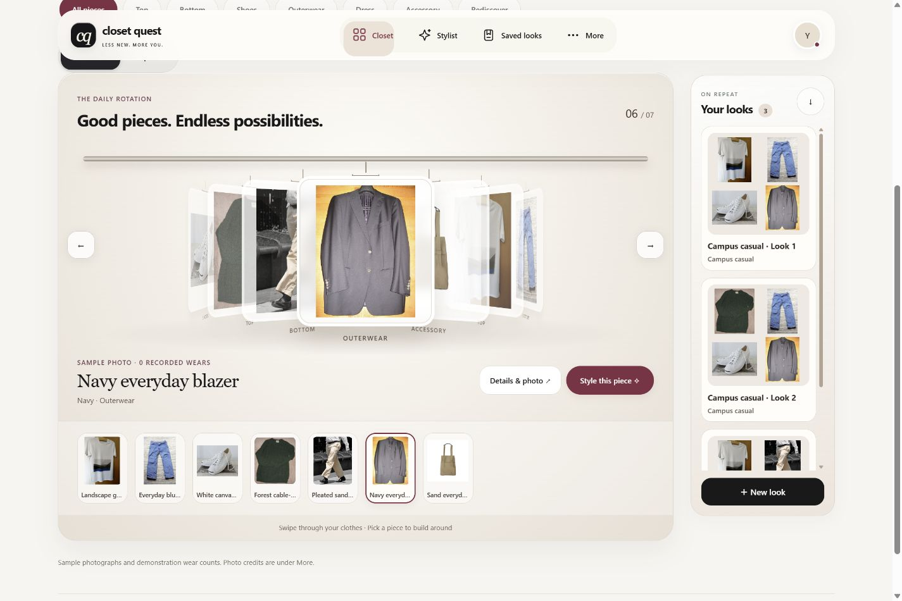
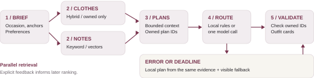

# Closet Quest: beta release

**Try the app:** [closet-quest-junhao-s7.onrender.com](https://closet-quest-junhao-s7.onrender.com/)  
**Source:** [github.com/noobyanjunhao/Closet-Quest](https://github.com/noobyanjunhao/Closet-Quest)  
November 17, 2026. Please try your own clothes and a real occasion, and tell us what worked and what got in your way.

## 1. The integrated beta

Closet Quest helps people make more use of what they own. A person adds photos, reviews the detected pieces, asks for an outfit, and saves or records wearing it. A small wardrobe produces a useful starting point with an explanation of what is missing. Retailer suggestions stay visibly separate from owned clothes; buying something is optional.

The beta connects account entry, multiple-photo review, private wardrobe storage, personal preferences, owned-clothes retrieval, outfit cards, saved looks and backup recovery. The interface keeps the current page, filters and outfit progress as the person navigates. Manual review and Quick styling offer paths that do not send a photo to an AI provider or make a generation request.

*Current local interface with seven sample garments and three Quick looks. Actual browser captures; no private wardrobe photos. These illustrate the flow, not recognition accuracy or human acceptance.*

React/Vite runs the interface; a Node 24 API enforces sessions, ownership, input limits and bounded jobs. Supabase provides Auth, Postgres and private photos; Render runs the free web service. Python supports offline ML experiments. Six specialist JavaScript modules coordinate retrieval, planning, selection and validation within one styling request.

The November 17 recovery fixed a real deployment blocker: the original database hostname could not resolve. An owner-approved Free replacement, fresh environment deployment and SMTP repair restored confirmation and sign-in. The import retained all **17 original records**; assisted review added two separate garments from existing photos. All **19 pieces and one Quick starter look survived reload** on release `77f50e3`, verified live on Render. A fresh backup contained **6/6 decodable photo records** representing four source photos plus two reuses. No wear or acceptance rating was recorded. CI passed **323 Node tests, 19 Python tests, CPU inference and build/container checks**. [Recovery](../output/sprint9/recovery-verification.json) and [release verification](../output/sprint9/final-release-verification.json) distinguish recovery from recognition accuracy and independent user testing.

## 2. What changed after the TA's feedback

The stylist filters preferences, retrieves reviewed garments and notes in parallel, constructs bounded outfit plans, chooses a route, and validates the result against owned IDs. Routine Automatic/Fast briefs can use local rules. Other briefs preserve the chosen model and make at most one generation attempt. A failed or timed-out call falls back to planning from the same retrieved wardrobe. Styling receives descriptions, preferences and selected excerpts, not photos. The trace records route, timing and fallback without copying private prompts.

| Concern / test | Before | Observed result and limit |
|---|---|---|
| 40 equivalent local HTTP shopping requests; 40 ms provider | 2/40 completed; 38/40 HTTP 429 | 40/40 completed, one provider call, p95 72.47 ms. Warm repeat: 40/40, zero calls, p95 15.30 ms. |
| Duplicate account catalog saves; 40 requests | 40 cloud writes | One cloud write; 40/40 responses still succeed. Separately, a $500 injected result is now excluded by a $50 budget. |
| Three refusals due to local capacity | Counted as provider failures; opened circuit | Zero provider failures; circuit stays closed. Only admitted work consumes an inference-budget check (4 to 1). |
| Provider outage with saved products; 40 requests | External dependency could block discovery | 40/40 return explicitly stale saved finds, one failed provider call. No price freshness claim. |

The burst experiment ran actual local HTTP shopping middleware with synthetic authentication/products/provider and zero external requests. Cloud-save, budget and circuit comparisons used injected in-process adapters. Forty distinct cold searches completed 40/40 at peak concurrency two (p95 900.91 ms). A 500 ms provider against a shortened 250 ms wait still produced **38/40 HTTP 503**, all with Retry-After. Bounded refusal remains necessary under overload. [HTTP results](../output/sprint9/shopping-http-validation.json) and [before](../output/sprint9/shopping-boundaries-before.json)/[after](../output/sprint9/shopping-boundaries-after.json) retain failures. These are operational improvements, not live retailer capacity or cost estimates.

The earlier paired stylist experiment used 12 synthetic briefs three times per route: **36 to 18 generation-fixture calls**, 36/36 completion and owned-only output in both routes. Median latency was 46.52 to 1.57 ms; p95 was 47.64 to 47.89 ms, so the tail did not improve. Four injected generation failures recovered after one attempt each. [Routing results](../output/sprint9/stylist-nfr.json) establish bounded behavior, not taste.

Recognition still needs human review. [Sprint 8's valid-piece salvage](../output/sprint8/model-results.json) improved original-image completion from **19/20 to 20/20**, but blurred category recall was **28/47 (59.6%)**. The later advisory check used those same 20 public photos in three conditions: **60 correlated observations**, not new phone uploads. It warned on 0/20 originals, 12/20 dim images and 20/20 downsampled/blurred images; the last result came from the resolution rule, not proof of blur detection or improved recall.

Four bounded live API checks on public samples returned a tee category in 5.20 s, valid owned wedding outfits in 3.09 s (Fast) and 8.11 s (Balanced), and two shoe products with image URLs in 12.24 s. Styling fallback was **0/2**. The recognition harness initially checked the wrong field; its saved result was reinterpreted without another paid call. These are capability checks, not an accuracy benchmark. [Raw live results](../output/sprint9/live-capabilities.json) preserve the original assertion and correction.

## 3. Independent testing and defect resolution

The fresh-context Ashley review found useful defects: a wedding result opened shopping in the wrong category, Quick claimed that evidence had entered a model, local backup import was missing, and save/navigation feedback was weak. The review agent received user goals and URLs without source code or previous reports. It operated a copied, frozen sample build with external calls disabled. The owner described human supervision; the recorded actions were agent-operated, so this evidence is reported separately from a person completing the workflow themselves.

| Problem observed | Resolution and evidence |
|---|---|
| Wedding advice suggested shoes but shopping retained Top | Reuse a previous category only if it matches the current gaps. A separate review snapshot selected Dress shoes. |
| Quick evidence implied a model call | Evidence now explains that references are available to read and no generative model was used. Retest recorded zero model attempts. |
| Local export had no import, then follow-up found a null-account crash | Import is available in both modes; validation preserves local scope or binds to the signed-in owner. Regression tests cover both paths. |
| Save confirmation disappeared; reload reset the current page | Persistent saved confirmation, a saved-look shortcut and per-account navigation continuity were added and tested. |
| “Cloud connection” obscured the actual account failure | Verified saved backend configuration, required fresh deployment, repaired confirmation delivery and added safe credential/mail guidance. Owner signup and sign-in succeeded. |

The review completed a synthetic add, wedding request, evidence inspection, rename/save and reload. Escape closed a modal; the Right arrow moved the rail. A separate five-check browser retest confirmed wedding context, save feedback and navigation continuity. These observations support defect resolution; they are not Ashley's endorsement of the outfits. [Review record](ashley-review.md) and [retest evidence](../output/sprint9/flow-completeness.json) identify the different snapshots.

The latest [closet UI check](../output/sprint9/closet-ui-review.json) verified three local viewport sizes (320, 390 and 1440 pixels wide), no wardrobe-page overflow, 7/7 sample images loading, retained keyboard focus, 44-pixel carousel controls and saved-look rail position after navigating away and back. Three Quick looks were generated and saved without a paid call. Selected caption/action contrast pairs were 5.19-8.54:1. Browser emulation is not a physical phone test, and these selected checks do not cover the whole interface.

**The independent-person session remains the open acceptance gate.** No completed direct-human session is recorded; the owner recovery walkthrough is a separate engineering check. Human top-three acceptance, correction time and evidence usefulness therefore remain unmeasured rather than being assigned zeroes or inferred from the agent's actions.

The prepared session covers six tasks: real phone-photo upload, correction, styling, save/wear, optional external finds and account re-entry. Its in-app export records passed/failed/skipped outcomes, assistance, missed pieces, correction count/time, top-three acceptance, evidence usefulness and fallback. The protocol freezes the revision, models and environment until the session ends; defects receive a priority, fix commit and separately recorded retest. [The handoff and checklist](sprint9-delivery-checklist.md) provide the concise user brief. This supplies the measurement process; the outside person's completed session will supply the remaining evidence.

## 4. Deployment, responsibility and remaining priorities

The repository includes locked dependencies, a Node 24 runtime, credential-isolated tests, a non-root container, health/version probes and concise user/developer/runbook documents. The release process is reproducible: `npm ci`, `npm test`, `npm run build`, then `npm start`. CPU deployments skip optional GPU downloads while retaining a tested CPU inference runtime. Deploy an inspected commit, verify `/version.json`, then test actual account entry and private save/read; do not call process liveness end-to-end readiness.

The free Render service can sleep, so cold starts remain visible to testers. Supabase is the durable store. The photo queue and rebuildable vector index are process-local; this is not a horizontally coordinated AI service. The optional tuned purchase worker still needs scoped credential registration and validation against the replacement backend; its fast-parser fallback remains available. AWS catalog code and local SDK/emulator experiments are included, but the AWS practice stack is **not deployed** while free-plan/service-activation gates remain unmet. No hosting upgrade was made. The separate $5 live-API allowance covered earlier bounded smoke checks, not recurring infrastructure.

| Responsibility area | Implemented check / remaining consequence |
|---|---|
| Ownership and recovery | Auth, owner-scoped rows/photos, stale-write rejection, private backup import and safe error messages. Replacement-project SQL checks passed owner access, cross-owner/anonymous denial and stale-write rejection. These are focused checks, not a penetration test. |
| Photo privacy and retention | Synthetic-file tests verify terminal-job photo cleanup and metadata expiry (30-minute production default). Manual review avoids AI analysis; styling omits photos. Saved cloud objects are not deleted by garment removal; provider copies/backups are not fully audited. |
| Explainability and shopping | Owned pieces and external finds are distinct; actual route/fallback and source links are visible. Retailer prices, variants, stock and dress-code suitability are not independently guaranteed. |
| Accessibility and bias | Keyboard rail controls, modal Escape, focus and reduced-motion support are present. Limited interface checks do not establish WCAG conformance or assistive-technology usability. No demographic fairness conclusion follows from public sample images. |

A new [scoped responsible-deployment audit](responsible-deployment-audit.md) passed **97/97 automated checks** across auth/ownership, job retention, bounded shopping, context boundaries and safe measurement exports. Its matrix explicitly marks full cloud erasure and provider retention open, and accessibility partial. A passing test count does not turn those open areas into certification.

**Next priorities:** first, finish and record one frozen outside-person session using unseen phone photos; second, fix its blockers and retest; third, complete cloud-photo erasure/retention and a manual accessibility audit; fourth, measure realistic cold/warm latency and shopping refusal rates before expanding traffic. Keep recognition recovery, outfit acceptance and correction burden as separate outcomes. The main remaining risk is a technically valid suggestion that still fails the person's practical needs.

The accompanying delivery package contains this report, supporting JSON results, a requirements checklist and concise [user](beta-user-guide.md), [developer](developer-guide.md) and [deployment](beta-deployment.md) guides. It excludes credentials, raw account backups and private photos. Historical experiments remain labeled with their dates and conditions; they are not silently presented as new user results.
