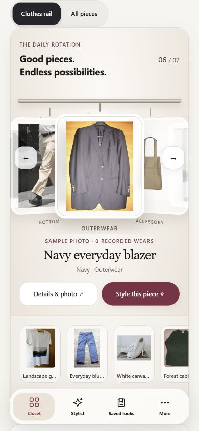

# Closet Quest: beta release

**Try the app:** [closet-quest-junhao-s7.onrender.com](https://closet-quest-junhao-s7.onrender.com/)  
**Source:** [github.com/noobyanjunhao/Closet-Quest](https://github.com/noobyanjunhao/Closet-Quest)  
November 17, 2026. If you try it, use your own clothes and a real occasion, and tell us what worked and what got in the way.

## 1. The integrated beta

Closet Quest helps people get more wear out of what they already own. You photograph your clothes, check what the app found, ask for an outfit for a specific occasion, and save it or log that you wore it. Even a small closet gets a usable starting point and a plain note about what is missing. Shopping suggestions sit in their own section, never mixed in with clothes you own, and buying anything is optional.

Everything is wired together now: sign-in, multi-photo review, private cloud storage, style preferences, retrieval from your own closet, outfit cards, saved looks and backup recovery. It remembers where you were as you move around, and if you would rather not send a photo to an AI provider, manual review and Quick styling work without any model call.

*Current interface with seven sample garments and three Quick looks. Real browser captures of the public sample set, not our private wardrobes. They show the flow, not recognition accuracy or user acceptance.*

The front end is React with Vite; a Node 24 API handles sessions, ownership checks, input limits and bounded background jobs. Supabase provides auth, Postgres and private photo storage, and Render runs the free web service. Python is for offline ML experiments only. Within one styling request, six small JavaScript modules share retrieval, planning, selection and validation.

The biggest fix this sprint was a real outage: on November 17 the original database hostname stopped resolving. We connected an approved replacement Free project, redeployed with the new environment and repaired email delivery, so confirmation and sign-in work again. The import kept all **17 original records**, and a manual review pass added two more garments from photos that were already there. All **19 pieces and one Quick starter look survived a signed-in reload** on release `77f50e3`, checked live on Render. A fresh backup held **6/6 decodable photo records** (four source photos, two reused). No wears or ratings were logged during recovery. CI on that release passed **323 Node tests, 19 Python tests, CPU inference and the build/container checks**. Details: [recovery](../output/sprint9/recovery-verification.json), [release verification](../output/sprint9/final-release-verification.json).

## 2. What changed after the TA's feedback

The stylist starts from your preferences, pulls reviewed garments and notes in parallel, builds a few bounded outfit plans, picks a route, and checks the result against the IDs you actually own. Routine Automatic/Fast requests can be answered with local rules. Everything else keeps the model you chose and makes at most one generation attempt; if that call fails or times out, the app plans from the same retrieved wardrobe and tells you it fell back. The model receives descriptions, preferences and selected note excerpts, never photos. The trace logs route, timing and fallback without copying private prompts.

| Concern / test | Before | Observed result and limit |
|---|---|---|
| 40 equivalent local HTTP shopping requests; 40 ms provider | 2/40 completed; 38/40 HTTP 429 | 40/40 completed with one provider call, p95 72.47 ms. Warm repeat: 40/40, zero calls, p95 15.30 ms. |
| Duplicate account catalog saves; 40 requests | 40 cloud writes | One cloud write; all 40 responses still succeed. Separately, a $500 injected result is now excluded by a $50 budget. |
| Three refusals due to local capacity | Counted as provider failures; opened the circuit | Zero provider failures; circuit stays closed. Only admitted work spends an inference-budget check (4 down to 1). |
| Provider outage with saved products; 40 requests | External dependency could block discovery | 40/40 return clearly labelled stale saved finds, one failed provider call. No freshness claim on prices. |

The burst test ran the real local HTTP shopping middleware with synthetic auth, products and provider, and made zero external requests. The cloud-save, budget and circuit comparisons used injected in-process adapters. Forty distinct cold searches completed 40/40 at peak concurrency two (p95 900.91 ms). When we slowed the provider to 500 ms against a 250 ms wait, **38/40 requests still got HTTP 503**, each with a Retry-After header, so bounded refusal is still part of the design under overload. The [HTTP results](../output/sprint9/shopping-http-validation.json) and the [before](../output/sprint9/shopping-boundaries-before.json)/[after](../output/sprint9/shopping-boundaries-after.json) files keep the failures visible. These are operational improvements; they say nothing about live retailer capacity or cost.

The earlier paired stylist experiment ran 12 synthetic briefs three times per route. Generation-fixture calls dropped from **36 to 18**, with 36/36 completion and owned-only output on both routes. Median latency fell from 46.52 ms to 1.57 ms, but p95 stayed flat (47.64 vs 47.89 ms), so the tail did not improve. Four injected generation failures each recovered after one attempt. The [routing results](../output/sprint9/stylist-nfr.json) show bounded behaviour, not good taste.

Recognition still needs a person in the loop. [Sprint 8's valid-piece salvage](../output/sprint8/model-results.json) took original-image completion from **19/20 to 20/20**, but blurred category recall was still **28/47 (59.6%)**. The newer advisory check reused those same 20 public photos in three conditions, so it is **60 correlated observations**, not new phone uploads. It warned on 0/20 originals, 12/20 dim images and 20/20 downsampled/blurred images; that last number comes from the resolution rule, so it is not proof the app detects blur or recalls more.

Four bounded live API checks on public samples returned a tee category in 5.20 s, valid owned wedding outfits in 3.09 s (Fast) and 8.11 s (Balanced), and two shoe products with image URLs in 12.24 s. Styling fallback was **0/2**. The recognition harness originally checked the wrong field; we reinterpreted the saved result without paying for another call. These are capability checks rather than an accuracy benchmark, and the [raw live results](../output/sprint9/live-capabilities.json) keep both the original assertion and the correction.

## 3. Independent testing and defect resolution

Our friend Ashley, who is not on the team, tested the app on November 16 with only the public URL and a list of goals, on a frozen sample build with outside calls disabled, and we changed no code while she worked. She added a garment, asked for a formal wedding look, inspected the evidence, renamed and saved the look, reloaded, and found it again in Saved looks; Escape closed the result modal and the Right arrow moved the rail. Along the way she found the first five defects below. Our own desktop and 375 px walkthrough of the live `77f50e3` release on November 17 found seven more.

| Problem observed | Resolution and evidence |
|---|---|
| Wedding advice suggested shoes, but shopping stayed on Top | A previous category is reused only when it matches the current gaps. A separate review snapshot selected Dress shoes. |
| Quick evidence implied a model call | The evidence panel now says the references are there to read and no generative model was used. Retest logged zero model attempts. |
| Local export had no import; a follow-up found a null-account crash | Import works in both modes; validation keeps local scope or binds to the signed-in owner. Regression tests cover both paths. |
| Save confirmation vanished; reload reset the page | Added a persistent saved confirmation, a saved-look shortcut and per-account navigation memory, all tested. |
| "Cloud connection" hid the real account failure | Verified the saved backend config, forced a fresh deployment, repaired confirmation email and added safe credential/mail guidance. Owner signup and sign-in then succeeded. |
| P2: saved-look card showed blank tiles when a look mixed pixel icons and photos | The collage CSS sized only photos, so icons filled the card and photos collapsed to zero width. Fix `6f18f13` sizes both; retest shows all five tiles with positive width on desktop and mobile. |
| P2: the free Quick route was buried under Preferences | `6f18f13` adds a visible Quick action beside the main button. Desktop and mobile retests returned three cards with zero generation attempts; Auto routing is unchanged. |
| P2: wardrobe matches sat in a nested scroll box on phones | `6f18f13` shows four matches and expands to all seven with no height cap. The retest caught a portal CSS override that re-capped it; that was fixed before the final check. |
| P3: empty shop shelf said "try All pieces" while All pieces was selected | `6f18f13` adds separate copy for an unfiltered empty library, confirmed in the browser. |
| P3: sign-in screen gave no cold-start context | `6f18f13` explains that the free host may take up to a minute to wake. Copy inspected; actual wake time was not measured. |
| P3: two near-identical "how this was made" disclosures on every card | `6f18f13` merges them into one section that keeps method, sources and garment facts; Quick still says no model was used. |
| P3: Quick repeated a generic "try this" tip | `6f18f13` drops the tip box for Quick results; absent in both retests. |

We retested the fixes on sample wardrobes at 1440 and 375 px with external calls blocked, so nothing in a real account changed and no paid call was made. All 323 Node tests and the build passed. The [UX retest file](../output/sprint9/ux-followup-validation.json) records the measured tile widths (93.47 px desktop, 42.05 px mobile minimum), the zero model attempts and the CSS failure caught along the way. We then deployed the fixes; a [hosted probe](../output/sprint9/ux-hosted-verification.json) at 02:29 EST on November 17 saw `/version.json` report `4418f2f`, a 200 health check in 222 ms and a normal 401 for synthetic credentials in 339 ms. The signed-in 19-piece reload was last verified on `77f50e3`. Ashley's [review notes](ashley-review.md), the [flow retest](../output/sprint9/flow-completeness.json) and the [closet check](../output/sprint9/closet-ui-review.json) hold the rest of the detail. After the fixes, Ashley's three original failures were rechecked on a second snapshot: shopping opened on Dress shoes, Quick showed zero model attempts, and backup import was present — all three passed.

## 4. Deployment, responsibility and remaining priorities

The repository ships with locked dependencies, a Node 24 runtime, tests that strip credentials, a non-root container, health and version probes, and short user, developer and runbook docs. The release process is `npm ci`, `npm test`, `npm run build`, then `npm start`. CPU deployments skip the optional GPU downloads and keep a tested CPU inference runtime. After deploying an inspected commit, check `/version.json`, then actually sign in and save and read something private; a live process is not the same as a working app.

The free Render service sleeps, so testers see cold starts. Supabase is the durable store. The photo queue and the rebuildable vector index live in the process, so this is not a horizontally coordinated AI service. The optional tuned purchase worker still needs its scoped credential registered and validated against the replacement backend; its fast-parser fallback is available in the meantime. The AWS catalog code and local SDK/emulator experiments are in the repo, but the AWS practice stack is **not deployed** because the free-plan and service-activation gates are still unmet. We made no hosting upgrade. The separate $5 live-API allowance paid for the earlier smoke checks, not for anything recurring.

| Responsibility area | Implemented check / remaining consequence |
|---|---|
| Ownership and recovery | Auth, owner-scoped rows and photos, stale-write rejection, private backup import and safe error messages. SQL checks on the replacement project passed owner access, cross-owner/anonymous denial and stale-write rejection. Focused checks, not a penetration test. |
| Photo privacy and retention | Synthetic-file tests confirm photo cleanup after terminal jobs and metadata expiry (30-minute production default). Manual review skips AI analysis; styling never sees photos. Removing a garment does not yet delete its saved cloud objects, and provider copies/backups are not fully audited. |
| Explainability and shopping | Owned pieces and external finds are kept apart; the real route, any fallback and source links are visible. Retailer prices, variants, stock and dress-code fit are not independently guaranteed. |
| Accessibility and bias | Keyboard rail controls, Escape to close modals, focus handling and reduced-motion support are in. The limited checks so far do not establish WCAG conformance or screen-reader usability, and public sample images support no fairness conclusion. |

A new [scoped responsible-deployment audit](responsible-deployment-audit.md) passed **97/97 automated checks** across auth/ownership, job retention, bounded shopping, context boundaries and safe measurement exports. Its matrix marks full cloud erasure and provider retention as open and accessibility as partial. A green test count does not close those.

**Next, in order:** finish cloud-photo erasure and retention; run a manual accessibility audit with a screen reader; then measure realistic cold/warm latency and shopping refusal rates before inviting more traffic. We keep recognition recovery, outfit acceptance and correction burden as separate outcomes. The main risk that remains is a suggestion that passes every technical check and still does not work for the person wearing it.

The delivery package contains this report, the supporting JSON results, a requirements checklist and the short [user](beta-user-guide.md), [developer](developer-guide.md) and [deployment](beta-deployment.md) guides. It leaves out credentials, raw account backups and private photos. Older experiments keep their original dates and conditions and are not presented as new user results.
