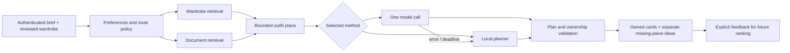

# Beta acceptance contract

These are release gates, not claims of universal accuracy. Updated November 16, 2026.

| Requirement | Acceptance target | Current evidence / remaining work |
|---|---|---|
| Grounding | Every returned owned item belongs to the reviewed request wardrobe; anchors and exclusions survive fallback | 36/36 requests per route in the paired fixture experiment; regression tests for ownership, anchors and malformed plans. Not fashion acceptance. |
| Recognition | Retain valid pieces when one detection is malformed; surface uncertainty and permit correction | Existing recovery tests. New phone-photo recall target: at least 90% on independently labeled unseen photos; not yet measured. Sprint 8 blurred recall was 59.6%. |
| Usability | Outside tester completes six tasks without coaching or code changes; no unresolved P1 defect; separately record top-three acceptance and correction seconds | Agent-assisted rehearsal available; direct human outcomes pending. Do not merge these denominators. |
| Latency | Fast styling bounds parallel retrieval at 4 s and generation at 12 s; canceled work must not launch fallback | Timeout/cancellation regressions. Local deterministic planner target p95 under 100 ms on the fixture machine. Public cold-start and phone end-to-end p95 remain unmeasured. |
| Reliability | Single generation attempt; same-evidence fallback for provider failure, invalid plans, abstention and deadline | 4/4 injected cases recover with owned pieces. No claim that provider outages were observed live. |
| Cost | Routine Auto/Fast requests avoid generation; offline stylist policy makes zero generation/embedding calls | 36 to 18 mocked generation calls on 12 briefs repeated three times. Offline override tested. Other app services have separate cost policies. No dollar savings inferred. |
| Security/privacy | Owner scope enforced, secrets server-only, exports allowlisted, operational trace contains no prompt/photo/note | Existing auth/ownership/export tests plus trace sentinel test. Full erasure, provider retention and independent security audit remain open. |
| Explainability | Display actual provider, route reason, latency and fallback; Quick must not claim a model used evidence | New bounded trace and user-facing explanation; targeted agent retest. |
| Accessibility | Keyboard navigation, modal Escape, visible focus, reduced motion; assess screen reader names | Limited agent checks only. Formal WCAG audit and actual assistive-technology session remain open. |
| Deployment | Locked dependencies, Node 24, credential-free tests/build/container smoke, exact deployed revision | Existing CI/runbook; a new commit must pass CI and hosted revision checks before calling it live. |

## Agent design and context boundary

The orchestrator is JavaScript on the Node server. It coordinates six bounded specialists: preference filtering, wardrobe retrieval, document retrieval, outfit planning, style selection and ownership validation. These are application modules, not six extra LLMs. Wardrobe and document retrieval run in parallel. Only the selection specialist can request one generation; model errors lead to deterministic planning, not recursive delegation or an escalating model cascade.

Automatic/Fast uses local rules for an exact allowlist of generic briefs when there is no free-text preference note or feedback history. Other briefs retain the configured provider. Explicit provider choices and controlled study conditions retain their route unless the operator sets `CLOSET_STYLIST_POLICY=offline`. Offline applies to styling only: it is not a global spending cap for photo recognition, shopping, hosting or other services. Request JSON cannot override this server setting.

Retrieval combines vocabulary matching and optional vectors, preserving category coverage. The model receives a bounded context of reviewed garment descriptions, supplied plan IDs, preferences and selected note excerpts. Output IDs are checked against server-built plans; the final validator reconstructs actual garment IDs. The trace contains stage labels/counts/timing, not private context. Explanations can still be wrong about suitability; a person must assess style and practical use.

## Reproduce without spending

`npm test` strips cloud credentials. `node scripts/evaluate-stylist-nfr.mjs` blocks network access and writes `output/sprint9/stylist-nfr.json`. The fake key in that script only activates routing; it is never sent. `node scripts/review-sandbox.mjs --port=4186` builds a copied local review with no credentials, no outbound server requests and no live recognition. Its sample wardrobe is not human recognition evidence. Keep the copied source and dependencies unchanged during a review; run a separate snapshot for a retest.

For an actual outside test, freeze the Git commit and model/configuration, use a participant code, record who operates the app, and export the six task outcomes. An agent-assisted review may be supervised by Ashley; it must not silently become a direct-human session. Preserve failures, skipped tasks and assistance in the results. Human acceptance must be supplied by the person, never inferred by the agent.
